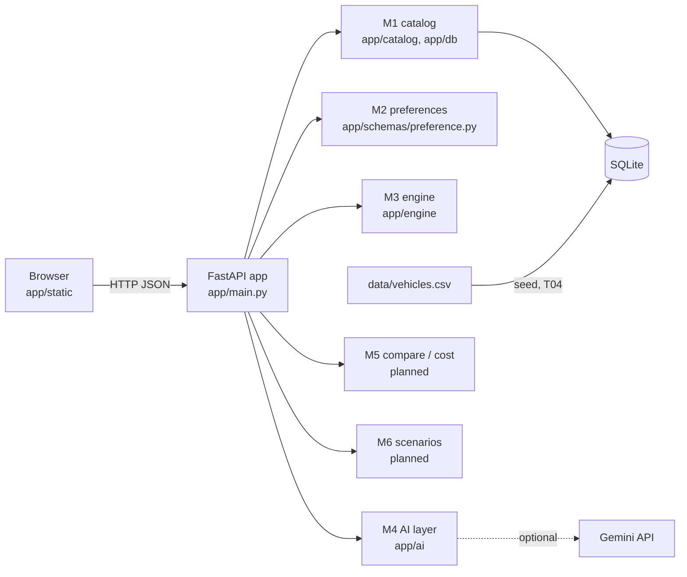

# AutoMatch — Architecture

> **Task:** T58 · **Status:** v0.1 — 2026-11-18 · **Author:** @azrashn
> Describes the repository as it is today. Parts not merged yet are marked *(planned)*.
> Related: [api-contract](api-contract.md), [data-dictionary](data-dictionary.md),
> [algorithm](algorithm.md), [ui-flow](ui-flow.md).

## 1. Overview

AutoMatch is **one FastAPI service** that also serves a static HTML/CSS/vanilla-JS
frontend. There is no separate frontend build step and no external service that is
required to run it. Data lives in a CSV file that is loaded into SQLite.

## 2. Modules and ownership

| Module | Folders / files | Responsibility | Owner (backup) |
| --- | --- | --- | --- |
| M1 Vehicle data and catalogue | `app/catalog/`, `app/db/`, `data/` | CSV, SQLite seed, `/api/vehicles` | Belis (Sude) |
| M2 Preferences and survey | `app/schemas/preference.py`, `app/static/survey.*` | Form and free-text preferences | Fatih (Orhan) |
| M3 Recommendation engine | `app/engine/` | Hard filters, weighted scoring, conflict report | Azra (Fatih) |
| M4 AI layer and explanations | `app/ai/` | `LLMProvider`, explanations, text parsing | Fatih (Azra) |
| M5 Comparison and cost | planned | `/api/compare`, annual cost, Chart.js views | Belis (Sude) |
| M6 Scenario Lab | planned | `/api/scenarios`, break-even km | karya-karya (Orhan) |

Modules talk to each other only through the shared Pydantic schemas in
`app/schemas/` (`Vehicle`, `Preference`, `Recommendation`), never by importing
each other's internals. This keeps cross-module dependencies small.

## 3. Request flow

1. The survey page (`app/static/survey.html`, `js/survey.js`) collects preferences.
2. The API validates them into a `Preference` object (M2).
3. The engine (M3) reads vehicles through the `Vehicle` schema, applies **hard
   filters** (budget, transmission, fuel, seats, body type), then scores each
   remaining vehicle: `score = 100 × Σ(w_i·s_i) / Σ(w_i)` with priority weights
   low/medium/high = 1/2/3. If nothing passes, a conflict report explains which
   constraints clash.
4. A `Recommendation` list is returned. Scoring, filtering and cost are pure
   deterministic Python; no AI is needed for them.
5. Optionally, M4 turns the result into a natural-language explanation.

## 4. AI layer and fallback (NFR-02)

`app/ai/provider.py` defines the abstract `LLMProvider`; only `app/ai/` may import the
Gemini SDK. `create_provider` returns `NoneProvider` by default
(`AI_PROVIDER=none`) or `GeminiProvider` when configured. Any misconfiguration
degrades to `NoneProvider` with a warning. Callers treat `LLMUnavailableError` and
`LLMProviderError` as "AI unavailable" and use a rule/template fallback, so the
application works fully without an API key. LLM output is untrusted and is validated
with Pydantic.

## 5. Application wiring

`app/main.py` builds the app in `create_app()`: `GET /health`, then one
`include_router(...)` line per module (currently commented out until each module
merges: M1 T05, M2 T12, M3 T25, M5 T42, M6 T50). `StaticFiles` is mounted **last**
at `/`, because it matches every path and would hide API routes registered after it.

## 6. Configuration

`app/config.py` reads settings from environment variables (see `.env.example`).

| Setting | Default | Meaning |
| --- | --- | --- |
| `app_name` | AutoMatch | API title |
| `app_env` | development | Environment name |
| `database_url` | SQLite `automatch.db` | SQLAlchemy URL |
| `vehicles_csv_path` | `data/vehicles.csv` | Seed source |
| `ai_provider` | `none` | `none` or `gemini` |
| `gemini_api_key` | empty | Secret, never logged or committed |

## 7. Data

`data/vehicles.csv` is the single source of the catalogue (19 columns, one row per
variant, official Turkish manufacturer sources, no guessed values). Rules are in
[data-dictionary](data-dictionary.md) and enforced by `tests/test_vehicle_csv.py`.

## 8. Technology choices

| Area | Choice | Why |
| --- | --- | --- |
| Backend | Python, FastAPI, Pydantic v2 | Typed schemas shared by all modules |
| Storage | SQLite + SQLAlchemy 2 | No server to run; enough for the catalogue size |
| Frontend | Static HTML/CSS/vanilla JS, Chart.js | No build step, easy for a 6-person team |
| i18n | `tr.json` / `en.json` | Turkish and English UI |
| AI | Optional Gemini via `LLMProvider` | Explanations only; never required |

## 9. Quality and CI

`.github/workflows/ci.yml` runs on pushes and PRs to `main`: `ruff check . --select
E9,F` and `python -m pytest --cov=app` with `AI_PROVIDER=none`. The `test` check is
required by branch protection, together with one approving review.

## 10. Known gaps

- M5 and M6 code and the catalogue router are not merged yet *(planned)*.
- The vehicle catalogue is small; more vehicles come with data tasks T08, T18, T28, T38, T47.
