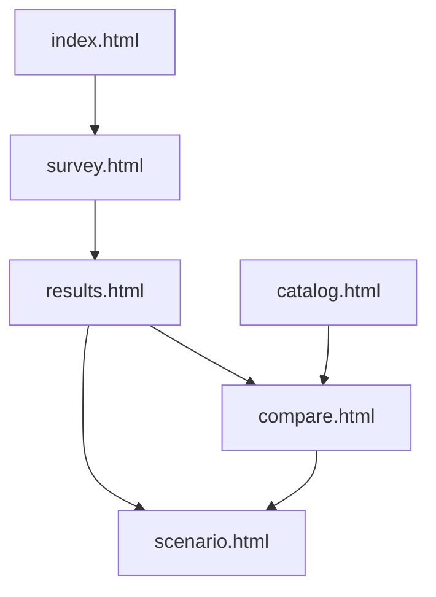

# AutoMatch UI Akışı ve Wireframe'ler

> **Not:** Endpoint'ler taslaktır; `docs/api-contract.md` merge olunca doğrulanacak.

Proje: AutoMatch (smart-car-recommender). Vanilla HTML/CSS/JS + FastAPI, tek servis.
Tüm sayfalar `app/static/` altındadır. UI metinleri kodda değil, `app/static/i18n/tr.json` ve `en.json` içinde tutulur; bu dokümanda yalnızca anahtar önerisi verilir.

## 1. Sayfa akış diyagramı



- `catalog.html` ayrı bir giriş noktasıdır; kullanıcı anket yapmadan doğrudan katalogdan karşılaştırmaya geçebilir.
- Ortak menü sayesinde her sayfadan diğer tüm sayfalara geçilebilir; diyagramı sadeleştirmek için bu oklar çizilmemiştir.

## 2. Sayfa tablosu

| Sayfa | Amaç | Endpoint(ler) | i18n öneki | Sahip modül |
| --- | --- | --- | --- | --- |
| `index.html` | Uygulamayı tanıtır ve kullanıcıyı ankete yönlendirir. | yok | `index.*` | M5 |
| `survey.html` | Kullanıcının tercihlerini form veya serbest metin ile toplar; serbest metinde onay adımı vardır (3.2b). | `POST /api/preferences/form`, `POST /api/preferences/text` | `survey.*` | M2 |
| `results.html` | Tercihlere göre ilk 5 aracı skor ve gerekçeyle listeler; scenario'ya geçiş sağlar. | `POST /api/recommendations` | `results.*` | M5 |
| `catalog.html` | Tüm araçları listeler ve detayını gösterir. | `GET /api/vehicles`, `GET /api/vehicles/{id}` | `catalog.*` | M1 |
| `compare.html` | 2-3 aracı yan yana tablo ve grafikle karşılaştırır. | `GET /api/compare?ids=1,2,3` | `compare.*` | M5 |
| `scenario.html` | Varsayımlar değişince sıralamanın nasıl değiştiğini gösterir. | `POST /api/scenarios` | `scenario.*` | M6 |

Ortak menü anahtarları `nav.*` önekini kullanır (bkz. bölüm 4).

## 3. Wireframe'ler

Metinler kısa yer tutucudur; gerçek metinler i18n dosyalarından gelir.

### 3.1 index.html

```text
+--------------------------------------------------+
| [Logo] Ana sayfa | Anket | Sonuçlar | Katalog |   |
|        Karşılaştır | Scenario Lab        [TR|EN]  |
+--------------------------------------------------+
|                                                  |
|            AutoMatch                             |
|      <kısa slogan: index.subtitle>               |
|                                                  |
|          [ Ankete başla ]                        |
|          [ Kataloğa göz at ]                     |
|                                                  |
+--------------------------------------------------+
| <3 kısa özellik kutusu>                          |
| [ Özellik 1 ] [ Özellik 2 ] [ Özellik 3 ]        |
+--------------------------------------------------+
```

### 3.2 survey.html

```text
+--------------------------------------------------+
| <ortak menü>                                     |
+--------------------------------------------------+
| Anket                                            |
| [ Form ] [ Serbest metin ]        <sekmeler>     |
+--------------------------------------------------+
| (Form sekmesi)                                   |
|  Bütçe:        [ min ____ ] [ max ____ ]         |
|  Gövde tipi:   [ v seçiniz ]                     |
|  Yakıt tipi:   [ v seçiniz ]                     |
|  Vites:        ( ) Manuel  ( ) Otomatik          |
|  Koltuk sayısı:[ v seçiniz ]                     |
|  Yıllık km:    [ ______ ] km                     |
|  Kullanım tipi:[ v seçiniz ]                     |
|  Öncelikler:   [x] Yakıt ekonomisi [ ] İç hacim  |
|                [ ] Performans [ ] Fiyat avantajı |
|                [ ] Güvenlik                      |
|                                                  |
|  [ Önerileri göster ]                            |
+--------------------------------------------------+
| (Serbest metin sekmesi: bkz. 3.2b)               |
+--------------------------------------------------+
```

- Bütçe min-max sert filtredir; min boşsa alt sınır yok.
- Koltuk sayısı sert filtredir.
- Yıllık km ve kullanım tipi FR-03 gereğidir; yıllık km olmadan maliyet hesaplanamaz.
- Kullanım tipi seçenekleri: TBD.

### 3.2b survey.html - serbest metin onay adımı

Akış: metin yaz -> [Tercihleri çıkar] -> "Anladığımız tercihler" kartı -> eksik alan varsa ek soru -> [Onayla ve önerileri göster].

```text
+--------------------------------------------------+
| <ortak menü>                                     |
+--------------------------------------------------+
| Anket                                            |
| [ Form ] [ Serbest metin ]        <sekmeler>     |
+--------------------------------------------------+
| (Serbest metin sekmesi)                          |
|  +--------------------------------------------+  |
|  | <ne aradığınızı yazın...>                  |  |
|  +--------------------------------------------+  |
|  [ Tercihleri çıkar ]                            |
+--------------------------------------------------+
| Anladığımız tercihler       Yöntem: <ai | rule>  |
|  Bütçe:        [ min ____ ] [ max ____ ]         |
|  Gövde tipi:   [ v <çıkarılan değer> ]           |
|  Vites:        ( ) Manuel  ( ) Otomatik          |
|  Yıllık km:    [ <çıkarılan değer> ] km          |
|  ...           (tüm alanlar düzenlenebilir)      |
+--------------------------------------------------+
| Eksik bilgi (yalnızca eksik alan varsa)          |
|  Yakıt türü tercihiniz var mı?  [ v seçiniz ]    |
+--------------------------------------------------+
|  [ Onayla ve önerileri göster ]                  |
+--------------------------------------------------+
```

- Kart, `POST /api/preferences/text` yanıtını kullanır: Preference + eksik alanlar + `method` (`ai` / `rule`).
- Kartta çıkarılan alanlar düzenlenebilir; çıkarma yöntemi kartın başlığında gösterilir.
- Eksik alanların her biri için bir ek soru gösterilir.
- Onaylanan tercih `automatch.preference` anahtarıyla sessionStorage'a yazılır ve `results.html` açılır.

### 3.3 results.html

```text
+--------------------------------------------------+
| <ortak menü>                                     |
+--------------------------------------------------+
| Sonuçlar - ilk 5 araç                            |
| <tercih özeti: bütçe, yakıt, ...>  [ Anketi düzenle ] |
+--------------------------------------------------+
| #1 +--------------------------------------------+|
|    | [kasa ikonu]  Marka Model      [ ] Karşılaştır|
|    | Fiyat: <fiyat> (örnek fiyat, <tarih> kontrol edildi) |
|    | Skor: [##########----] 82/100              ||
|    | Yıllık tahmini enerji maliyeti: <maliyet> TL ||
|    | Güçlü:  + yakıt ekonomisi  + fiyat         ||
|    | Zayıf:  - bagaj hacmi                      ||
|    | Açıklama: <neden önerildiğini anlatan metin>||
|    +--------------------------------------------+|
| #2 +--------------------------------------------+|
|    | ... aynı kart yapısı ...                   ||
|    +--------------------------------------------+|
| #3 ... #4 ... #5                                 |
+--------------------------------------------------+
| [ Seçilenleri karşılaştır ]   [ Senaryo dene ]   |
+--------------------------------------------------+
```

- "Yıllık tahmini enerji maliyeti" satırı FR-11 gereğidir. Değerin kaynağı (`POST /api/recommendations` yanıtı mı, `/api/compare` mı) TBD (bkz. bölüm 5).
- [Senaryo dene] `scenario.html` sayfasını açar.

### 3.3b results.html - boş sonuç / çelişki raporu

FR-09: sonuç çıkmazsa kartlar yerine çelişki raporu gösterilir.

```text
+--------------------------------------------------+
| <ortak menü>                                     |
+--------------------------------------------------+
| Kriterlerinize uyan araç bulunamadı              |
| <tercih özeti: bütçe, yakıt, ...>                |
+--------------------------------------------------+
| Engelleyen kısıtlar                              |
|  - Bütçe   -> Bunu gevşetirsen N araç açılır     |
|  - Vites   -> Bunu gevşetirsen N araç açılır     |
|  - Yakıt   -> Bunu gevşetirsen N araç açılır     |
|  - Koltuk  -> Bunu gevşetirsen N araç açılır     |
+--------------------------------------------------+
| [ Anketi düzenle ]                               |
+--------------------------------------------------+
```

- Veri kaynağı: `POST /api/recommendations` çıktısındaki ConflictReport (sözleşmede "ya sonuç ya çelişki raporu").
- Listede yalnızca engelleyen kısıtlar gösterilir; yukarıdakiler örnektir.
- ConflictReport içindeki alan adları: TBD (`docs/api-contract.md` ile doğrulanacak).
- [Anketi düzenle] `survey.html` sayfasını açar.

### 3.4 catalog.html

```text
+--------------------------------------------------+
| <ortak menü>                                     |
+--------------------------------------------------+
| Katalog                                          |
| Filtre: [ Marka v ] [ Yakıt v ] [ Gövde v ]      |
|         [ Fiyat min-max ]            [ Ara ]     |
+--------------------------------------------------+
| +------------+ +------------+ +------------+     |
| |[kasa ikonu]| |[kasa ikonu]| |[kasa ikonu]|     |
| | Marka M.   | | Marka M.   | | Marka M.   |     |
| | <fiyat>*   | | <fiyat>*   | | <fiyat>*   |     |
| | [Detay]    | | [Detay]    | | [Detay]    |     |
| | [ ] Seç    | | [ ] Seç    | | [ ] Seç    |     |
| +------------+ +------------+ +------------+     |
| * örnek fiyat, <tarih> kontrol edildi            |
+--------------------------------------------------+
| [ Seçilenleri karşılaştır ]                      |
+--------------------------------------------------+
```

Araç detayı (`GET /api/vehicles/{id}`) modal olarak açılır; ayrı sayfa yoktur.

### 3.5 compare.html

```text
+--------------------------------------------------+
| <ortak menü>                                     |
+--------------------------------------------------+
| Karşılaştır (2-3 araç)          [ Araç ekle/çıkar ] |
+--------------------------------------------------+
| Özellik      | Araç A    | Araç B    | Araç C    |
|--------------+-----------+-----------+-----------|
| Fiyat        | ...       | ...       | ...       |
| Yakıt        | ...       | ...       | ...       |
| Tüketim      | L/100km   | kWh/100km | L/100km   |
|              | veya kWh/100km (elektrikli)       |
| Yıllık maliyet | ...     | ...       | ...       |
| Güç          | ...       | ...       | ...       |
| Vites        | ...       | ...       | ...       |
+--------------------------------------------------+
| Grafik (Chart.js çubuk grafik)                   |
|  Metrik: [ v Fiyat ]                             |
|   ####                                           |
|   ####   ######                                  |
|   ####   ######   ###                            |
|   A      B        C                              |
+--------------------------------------------------+
| [ Senaryo dene ]                                 |
+--------------------------------------------------+
```

### 3.6 scenario.html

```text
+--------------------------------------------------+
| <ortak menü>                                     |
+--------------------------------------------------+
| Scenario Lab                                     |
+--------------------------------------------------+
| Varsayımlar                                      |
|  Yıllık km:      [----o-----------] 15.000 km    |
|  Yakıt fiyatı:   [-------o--------] <yakıt fiyatı> TL/L |
|  Elektrik fiyatı: [---o---] <elektrik fiyatı> TL/kWh (örnek fiyat) |
|                                                  |
| Öncelik ağırlıkları (0 Hiç, 1 Düşük, 2 Orta, 3 Yüksek) |
|  Yakıt ekonomisi: [0-1-2-(3)]  Yüksek (3) - %37,5 |
|  İç hacim:        [0-1-(2)-3]  Orta (2) - %25    |
|  Performans:      [0-(1)-2-3]  Düşük (1) - %12,5 |
|  Fiyat avantajı:  [0-1-(2)-3]  Orta (2) - %25    |
|  Güvenlik:        [(0)-1-2-3]  Hiç (0) - %0      |
|                                                  |
|  [ Sıfırla ]                                     |
+--------------------------------------------------+
| Sıralama: önce / sonra                           |
|  +-------------------+   +-------------------+   |
|  | ÖNCE              |   | SONRA             |   |
|  | 1. Araç A         |   | 1. Araç B   (^1)  |   |
|  | 2. Araç B         |   | 2. Araç A   (v1)  |   |
|  | 3. Araç C         |   | 3. Araç C   (=)   |   |
|  | 4. ...            |   | 4. ...            |   |
|  | 5. ...            |   | 5. ...            |   |
|  +-------------------+   +-------------------+   |
+--------------------------------------------------+
```

- Ağırlık sürgüleri 0-3 ölçeğindedir. Yanındaki yüzde, arayüzün hesapladığı ağırlık / toplam ağırlık oranıdır.
- Puan formülü ağırlıkların toplamına böler; yüzde yalnızca gösterim içindir.
- Tüm ağırlıklar 0 ise ağırlıklar eşit kabul edilir.
- Elektrik fiyatı sürgüsünün varsayılan değeri "örnek fiyat" etiketiyle gösterilir.

### 3.6b Boş durum (tercih yok)

`scenario.html` veya `results.html` açıldığında sessionStorage'daki `automatch.preference` boşsa kullanıcı `survey.html` sayfasına yönlendirilir ve "Önce anket yapın" mesajı gösterilir. Kullanıcı `catalog.html` üzerinden geldiyse de aynı kural geçerlidir.

```text
+--------------------------------------------------+
| <ortak menü>                                     |
+--------------------------------------------------+
| (!) Önce anket yapın                             |
+--------------------------------------------------+
| Anket                                            |
| [ Form ] [ Serbest metin ]        <sekmeler>     |
| ... survey.html formu (bkz. 3.2) ...             |
+--------------------------------------------------+
```

## 4. Ortak menü

Menü tüm sayfalarda aynıdır. Sıra soldan sağa:

| Sıra | Öğe | Link | i18n anahtarı |
| --- | --- | --- | --- |
| 1 | Ana sayfa | `index.html` | `nav.home` |
| 2 | Anket | `survey.html` | `nav.survey` |
| 3 | Sonuçlar | `results.html` | `nav.results` |
| 4 | Katalog | `catalog.html` | `nav.catalog` |
| 5 | Karşılaştır | `compare.html` | `nav.compare` |
| 6 | Scenario Lab | `scenario.html` | `nav.scenario` |
| 7 | Dil seçici (TR/EN) | yok (aynı sayfada dil değiştirir) | `nav.language` |

Aktif sayfa menüde vurgulanır. Dil seçimi `tr.json` / `en.json` arasında geçiş yapar.

## 5. Kararlar ve açık sorular

### Kararlar

- **i18n anahtarları:** Sayfa öneki + nokta ile alt düzey kullanılır (`survey.budget.label`, `results.card.strengths`); ortak metinler (Karşılaştır, "örnek fiyat") `common.*` altındadır. `tr.json` ve `en.json` aynı anahtar kümesine sahip olur ve bu, iki dosyanın anahtarlarını eşleştiren küçük bir testle kontrol edilir. (Karar: Azra; son karar T15 sahibi Fatih'te.)
- **Veri taşıma:** Tercih ve öneri sonucu sessionStorage'da `automatch.preference` anahtarıyla tutulur; karşılaştırma URL'de `?ids=1,2,3` ile taşınır (API ile aynı, paylaşılabilir). `automatch.preference` boşsa kullanıcı `survey.html`'e yönlendirilir (bkz. 3.6b). (Karar: Azra)
- **Hibrit araçlar:** Hibritler `consumption_l_100km` ile, elektrikliler kWh/100km ile gösterilir; tüketim satırında dolu olan birim yazılır, birimler çevrilmez. Karşılaştırılabilirliği "Yıllık maliyet" satırı sağlar; plug-in hibrit kapsam dışıdır. Belis'ten `fuel_type` değerlerini T02 veri sözlüğünde netleştirmesi istenecek. (Karar: Azra; fuel_type veri sözlüğü: Belis.)
- **Bütçe:** Min-max sert filtredir, min opsiyoneldir (`budget_min` Preference şemasında opsiyonel; Fatih ile T10'da netleşecek). "Bütçeye uygunluk" önceliği "Fiyat avantajı" adını alır. (Öneri: Azra; budget_min Fatih ile T10'da netleşecek.)
- **Araç detayı:** Modal olarak açılır, ayrı sayfa yoktur. (Karar: Azra)
- **Ağırlıklar:** Normalizasyon gerekmez; sürgüler 0-3 ölçeğindedir. (Karar: Azra)
- **Elektrik fiyatı sürgüsü:** Vardır; varsayılan değer "örnek fiyat" etiketiyle gösterilir. (Karar: Azra)

### Açık sorular

- **Sonuç kartındaki yıllık maliyetin kaynağı:** `POST /api/recommendations` yanıtı mı, `/api/compare` mı: TBD.
- **Yakıt ve elektrik fiyatı varsayılanları:** Varsayılan değerlerin nerede tutulacağı (config mi, istek mi): TBD.
- **Kesin alt anahtar adları:** Hangi alt anahtar adlarının (ör. `results.card.*`) kesin olduğu: Fatih (T15).
